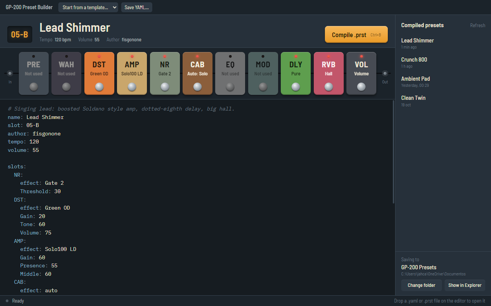

# GP-200 Preset Builder

A desktop application for creating and editing presets for the Valeton GP-200 multi-effects pedal. Write your effect chains in human-readable YAML, compile them to `.prst` binaries the pedal understands, and decompile existing presets back to YAML for inspection or editing.

Built with Electron 30, React 18, TypeScript, and Vite. No Python installation required on end-user machines — a standalone Python 3.11 runtime is bundled into the installer automatically during the build.

---

## Features

- **YAML-based workflow** — define effect chains in a readable, version-controllable format instead of navigating menus on the pedal
- **Compile & decompile** — convert YAML to `.prst` binary and back, byte-exact with what the pedal exports
- **All 305 effects** of firmware 1.8 with their real names, ranges and options (from Valeton's own editor data)
- **Live validation** — unknown effects, misspelled parameters and out-of-range values are listed under the editor as you type, with suggestions
- **Autocomplete** — effect names per module, parameters per effect, menu options and tempo-sync notes (`Ctrl+Space`)
- **Visual effect chain** — see all 11 modules (PRE, WAH, DST, AMP, NR, CAB, EQ, MOD, DLY, RVB, VOL) rendered as a live diagram that updates as you type
- **Syntax-highlighted editor** — CodeMirror 6 with One Dark theme and YAML language support
- **Preset templates** — start from Clean, Crunch, Lead, Ambient Pad or Metal baselines
- **Preset manager** — browse, load, and inspect all `.prst` files in your output directory
- **Drag-and-drop** — drop a `.yaml` or `.prst` file onto the editor to open it
- **Keyboard shortcuts** — compile, save, open, and new preset without leaving the keyboard
- **Persistent state** — window position, last YAML content, and output directory survive restarts

---

## Screenshots



---

## Requirements

### Running from source

| Tool | Version |
|------|---------|
| Node.js | 18 LTS or 20 LTS |
| npm | 9+ |
| Python | 3.x with PyYAML (dev only) |
| OS | Windows 10/11 x64 |

### Installing the pre-built app

Windows 10/11 x64. No additional runtime required — Python is bundled.

---

## Getting started

### Development

```bat
git clone https://github.com/fisgonone/gp200-preset-builder.git
cd gp200-preset-builder

npm install

# Make sure the sibling toolkit repo is present:
# ../gp200-toolkit/prst_compile.py
# ../gp200-toolkit/prst_decompile.py

pip install pyyaml   # system Python, used only in dev mode

npm run dev
```

The app opens at 1280×800 with hot reload. The main process restarts automatically on changes to `src/main/`; the renderer uses Vite HMR.

### Building the Windows installer

**Step 1 — prepare the embedded Python runtime (one-time, or after toolkit changes)**

```bat
npm run prepare-python
```

Downloads `python-3.11.9-embed-amd64.zip`, installs pip + PyYAML inside it, and copies the toolkit (scripts, `gp200/` package and effect catalog) into `resources/python/compiler/`. Set `GP200_TOOLKIT` to use a toolkit that isn't at `../gp200-toolkit`. The zip is cached in `.cache/` so subsequent runs are fast.

**Step 2 — build and package**

```bat
npm run package:win
```

Or use the combined pipeline:

```bat
node scripts/build-windows.js
```

Output: `dist/GP-200 Preset Builder Setup 1.0.0.exe`

---

## Writing presets

```yaml
name: Lead Shimmer        # up to 16 characters
tempo: 120
volume: 55

slots:
  DST:
    effect: Green OD
    Gain: 20
    Volume: 75
  AMP:
    effect: Solo100 LD
    Gain: 60
  CAB:
    effect: auto          # cabinet matching the amp
  DLY:
    effect: Pure
    Sync: ON
    Time: 1/8D            # note value, follows the tempo

ctrl:
  CTRL1: [DST]            # footswitch CTRL1 toggles the overdrive
```

Modules you leave out stay as in the pedal's init patch (switched off, VOL on);
parameters you leave out keep their defaults. The full format (signal-chain
order, FX loop, EXP pedal, CTRL footswitches) is documented in the
[gp200-toolkit README](https://github.com/fisgonone/gp200-toolkit#yaml-format).
Decompiling a `.prst` gives you every parameter with its range as a comment.

---

## Keyboard shortcuts

| Shortcut | Action |
|----------|--------|
| `Ctrl+B` | Compile YAML to .prst |
| `Ctrl+S` | Save As YAML |
| `Ctrl+O` | Pick output directory |
| `Ctrl+Space` | Show autocomplete suggestions |
| `Ctrl+N` | New blank preset |

---

## Project structure

```
src/
  main/           Electron main process — window management, IPC handlers, Python bridge
  preload/        contextBridge — exposes window.api to the renderer
  renderer/       React application (Vite)
    src/
      App.tsx         Root component, layout, keyboard shortcuts, drag-drop
      store.ts        Zustand global state (yaml, parsedPreset, outputDir, status)
      types.ts        SlotKey enum, slot colors, ParsedPreset type
      components/     SlotChain, YamlEditor, PresetList, CompileButton, StatusBar, …
      lib/            yaml-parser.ts, catalog-types.ts
  shared/         IPC contract types shared between main and renderer
scripts/
  prepare-python.js   Downloads and configures the embedded Python runtime
  build-windows.js    Full build pipeline (prepare → build → package)
tests/
  compiler.test.ts          Vitest: Python compiler bridge
  renderer/App.test.tsx     Vitest + jsdom: React smoke tests
resources/
  python/     Created by prepare-python (gitignored, ~50 MB)
  icon.ico    Application icon
```

---

## Tech stack

| Layer | Technology |
|-------|-----------|
| Desktop shell | Electron 30 |
| UI framework | React 18 + TypeScript |
| Build tool | Vite (via electron-vite) |
| Styling | Tailwind CSS (custom dark theme) |
| Editor | CodeMirror 6 |
| State | Zustand |
| Persistence | electron-store |
| Compiler runtime | Python 3.11 (embedded) |
| Packaging | electron-builder + NSIS |
| Testing | Vitest + jsdom + Testing Library |

---

## Running tests

```bat
# Main process tests (compiler bridge)
npm test

# Renderer tests (jsdom)
npx vitest run --config vitest.renderer.config.ts
```

---

## Related

- [gp200-toolkit](https://github.com/fisgonone/gp200-toolkit) — the Python compiler and YAML schema that this app wraps

---

## Troubleshooting

**`python` not found in dev mode**
Make sure Python 3.x is on your PATH. Verify with `python --version` in a new terminal.

**Compiler exits with code 1**
The problems panel under the editor lists every issue with its location, e.g. `slots.DLY: unknown DLY effect 'Digital Delay'. Did you mean: Digital Delay S?`. To browse effects from a terminal: `python ../gp200-toolkit/prst_info.py effects AMP` or `prst_info.py effect "UK 800"`.

**`npm install` doesn't download Electron (npm 11+)**
npm 11 blocks install scripts by default; `package.json` already allows the two this project needs (`allowScripts`). If you still see the warning, run `npm install-scripts approve electron esbuild` and then `npm rebuild electron esbuild`.

**`prepare-python.js` fails on extraction**
Requires PowerShell 5+ (`Expand-Archive`). Available on all Windows 10/11 systems.

**App window is blank on first launch**
The renderer likely failed to load. Open DevTools with `Ctrl+Shift+I` and check the console for errors.

**`resources/python/` is very large**
Expected — the embeddable Python runtime plus packages is ~50 MB. It is included in the installer but excluded from git via `.gitignore`.

---

## License

MIT
